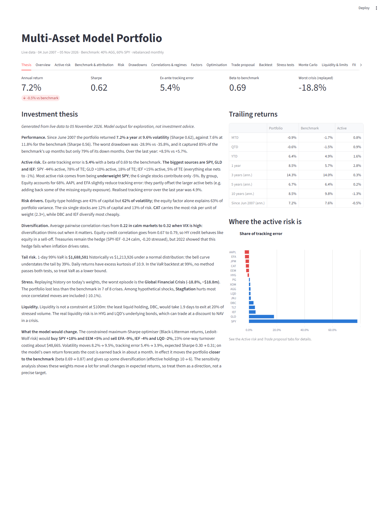
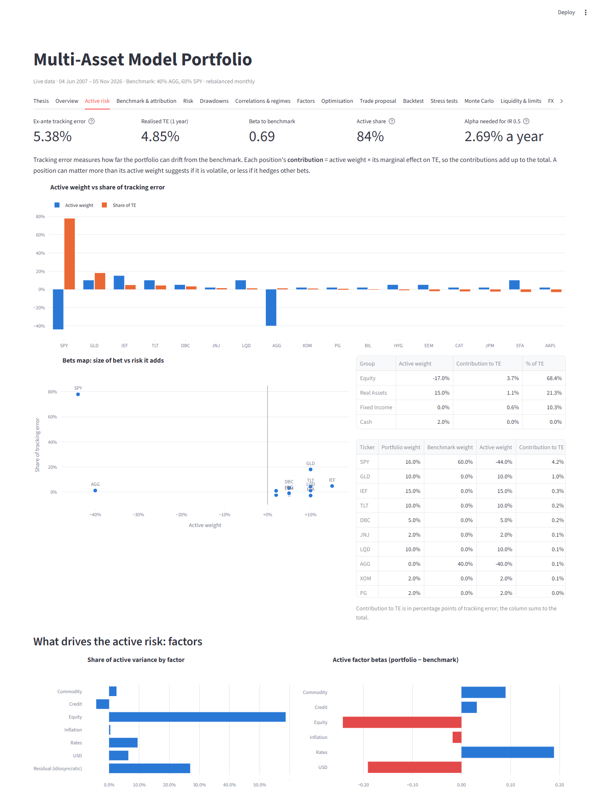
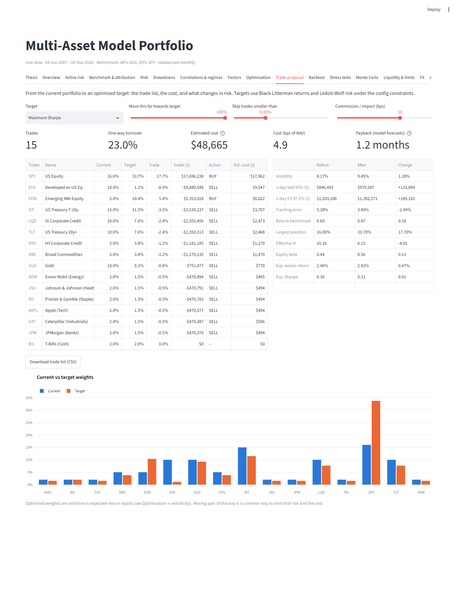
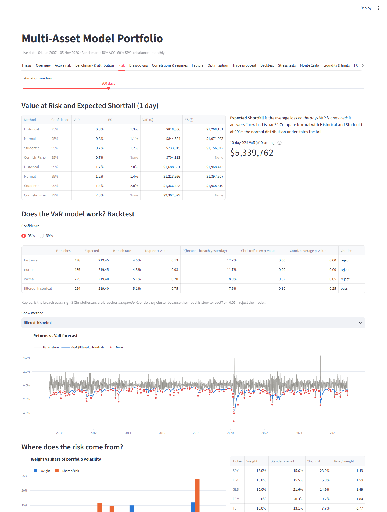
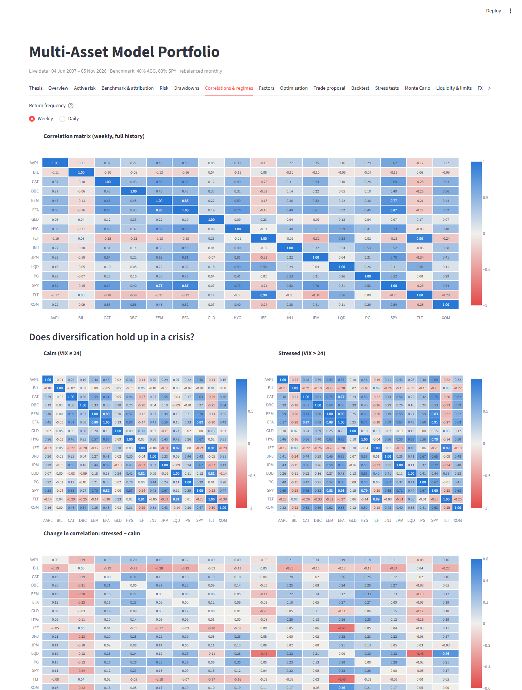
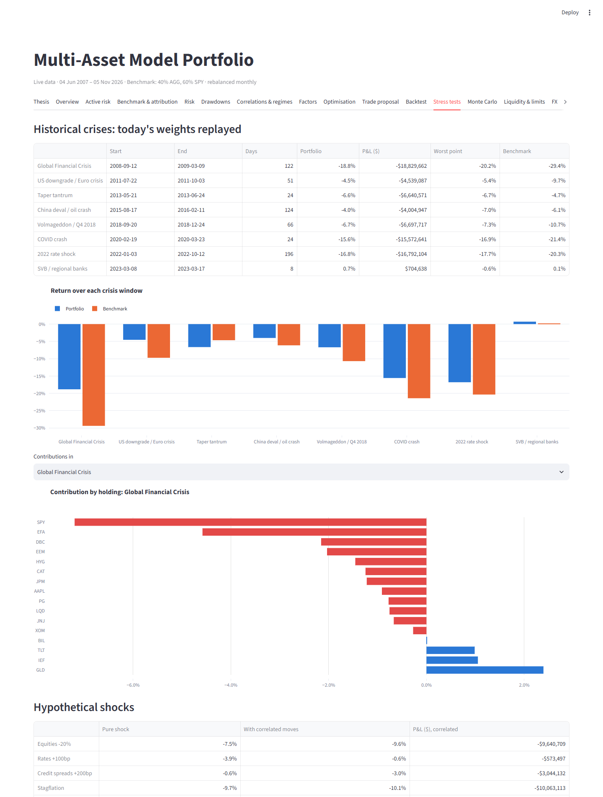
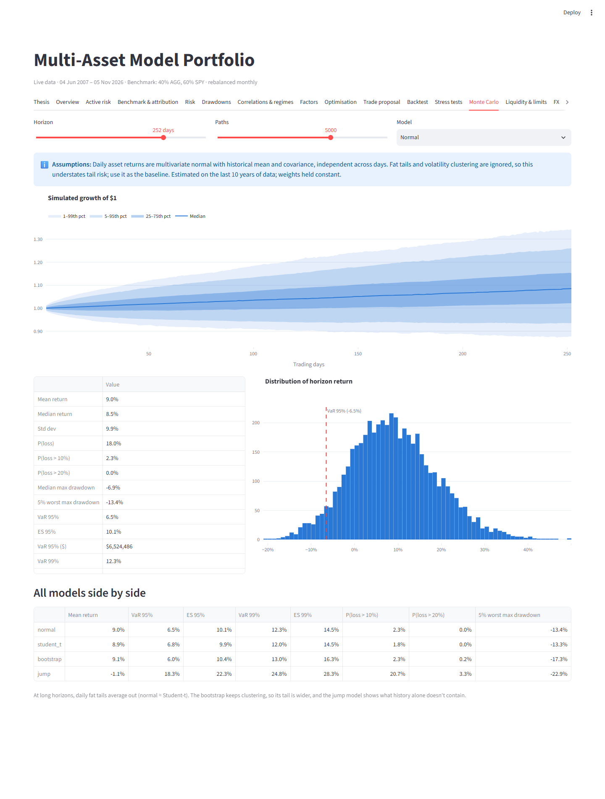
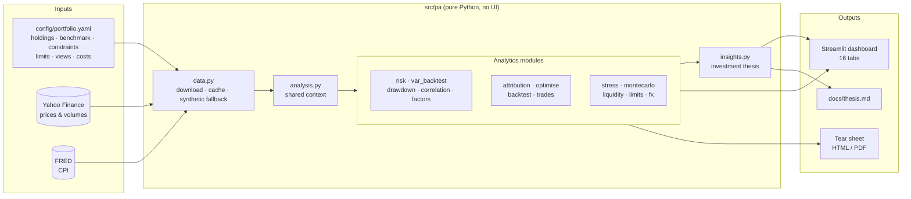
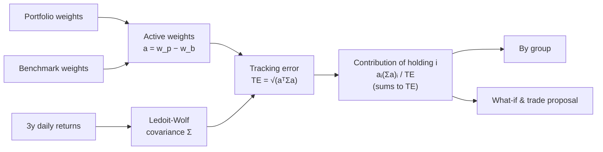
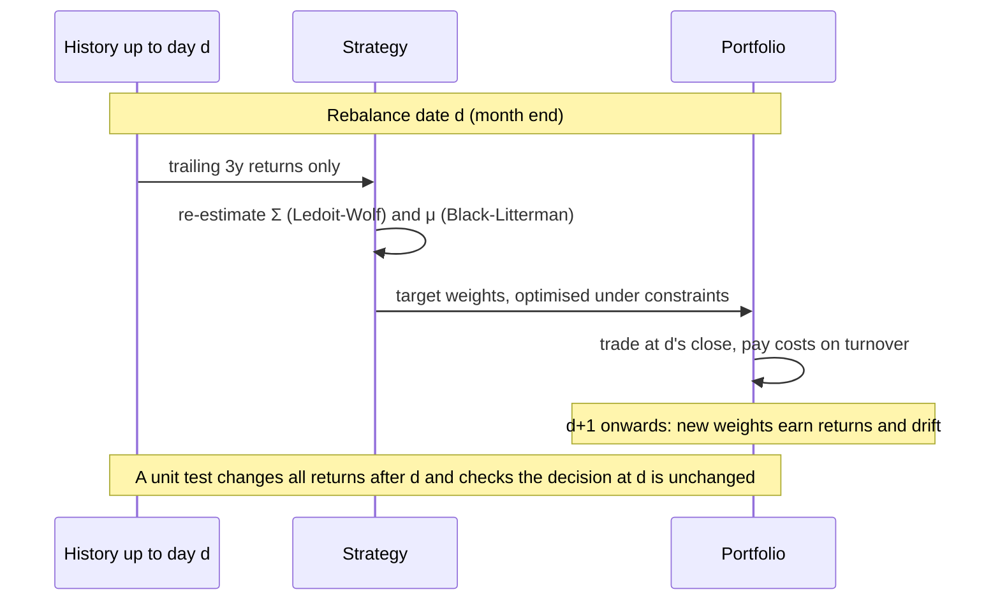

# Multi-Asset Portfolio Analytics

[](https://github.com/cristianahobbs/portfolio_analytics/actions/workflows/tests.yml)


A portfolio risk and analytics toolkit in Python, built to answer the questions a portfolio manager asks: *How much risk am I taking relative to my benchmark, and where does it come from? What happens in a crisis? What would I change, and is it worth the trading cost?*

It analyses a model portfolio of **10 ETFs and 6 single stocks** across equities, government bonds, credit, commodities and cash, against a 60/40 benchmark, using real market data from 2007 onwards. The results appear in a 16-tab interactive dashboard, an auto-generated investment thesis and a one-page tear sheet.

> **Disclaimer.** This is a personal project for learning and exploration. Nothing here is investment advice.



---

## The thesis in 30 seconds

*Snapshot from live data to 5 November 2026. The full version, generated from the numbers, is in [`docs/thesis.md`](docs/thesis.md).*

- **Better risk-adjusted, slightly lower return.** 7.2% a year at 9.6% volatility (Sharpe 0.62) vs 7.6% at 11.8% for the 60/40 (Sharpe 0.56). The max drawdown was −28.9% vs −35.8%.
- **Active risk is one big bet.** Ex-ante tracking error is 5.4%, and **78% of it comes from being underweight SPY**. The six single stocks together *reduce* tracking error slightly.
- **Diversification thins out in stress.** Average correlation rises from 0.22 (calm) to 0.32 (high VIX), and HY credit's correlation with equities rises to 0.79.
- **The normal distribution understates the tail by 39%** at 99% VaR. In backtests, only filtered historical simulation passes at 95%, and no method passes at 99%, so VaR is best read as a lower bound.
- **The portfolio lost less than the 60/40 in 7 of 8 historical crises.** The worst replay is the GFC (−18.8% vs −29.4%).
- **The optimiser's suggestion** (buy SPY, sell EFA) would cut tracking error from 5.4% to 3.9% for about 5 bps of trading cost. It does this mainly by moving closer to the benchmark.

---

## Highlights

### Active risk: where the tracking error comes from
Ex-ante tracking error is split into each position's contribution, along with a factor breakdown of *active* returns, a "bets map" (size of bet vs risk it adds), and a what-if tool for resizing any position.



### Trade proposal: from analysis to action
Choose a target (max Sharpe, min vol, risk parity, HRP) and how far to move towards it. You get a dollar trade list, cost estimates (commission plus half-spread), before/after risk (vol, VaR, ES, TE, beta) and the payback period. The trade list exports as CSV.



<details>
<summary><b>More screenshots</b>: risk, correlations, stress tests, Monte Carlo</summary>





</details>

---

## What it covers

| Area | What's included |
|---|---|
| **Performance** | Trailing returns (MTD to since inception), calendar years, Sharpe/Sortino/Calmar/Omega, skew/kurtosis, net-of-fee and inflation-adjusted returns |
| **Is the Sharpe real?** | Bootstrap confidence intervals, Probabilistic Sharpe, Deflated Sharpe (corrects for testing many strategies) |
| **Active risk** | Ex-ante tracking error, contribution to TE by holding/group/factor, active share, beta to benchmark, what-if tool |
| **Attribution** | Return contribution by holding; Brinson-Fachler allocation/selection/interaction, Carino-linked; single stocks vs SPY |
| **Risk** | VaR & ES (historical, normal, Student-t, Cornish-Fisher); risk contributions; component & incremental VaR; EWMA/GARCH vol; vol targeting; DV01/CS01 |
| **VaR backtesting** | Kupiec (frequency) and Christoffersen (clustering) tests on rolling out-of-sample forecasts |
| **Drawdowns** | Depth, peak-to-trough time and recovery time |
| **Correlations** | Daily vs weekly, rolling, calm vs stressed (VIX regimes), 2-state hidden Markov model |
| **Factors** | Equity, rates, credit, inflation, USD, commodity betas; systematic vs idiosyncratic risk per holding |
| **Optimisation** | Max Sharpe, min vol, risk parity, HRP, equal weight under realistic constraints; Black-Litterman; Ledoit-Wolf; sensitivity & resampling |
| **Backtesting** | Walk-forward with no look-ahead, transaction costs, calendar vs band rebalancing, cost sensitivity |
| **Stress tests** | 8 historical crises replayed; hypothetical shocks, pure and with correlated moves; build-your-own scenario |
| **Monte Carlo** | Normal, Student-t, block bootstrap, crash-jump model, each with its assumptions stated |
| **Liquidity & limits** | Days to liquidate, liquidity-adjusted VaR, fund-size scaling; green/amber/red limit monitor with breach history |
| **FX** | Hedged vs unhedged returns for a GBP investor |

---

## How it works

### Architecture



### Active risk decomposition



### Walk-forward backtest: no look-ahead



---

## Quick start

```bash
git clone https://github.com/cristianahobbs/portfolio_analytics.git
cd portfolio_analytics
python -m venv .venv
.venv\Scripts\activate            # macOS/Linux: source .venv/bin/activate
pip install -e ".[dev]"

streamlit run app/dashboard.py    # dashboard at http://localhost:8501
python -m pa.insights             # regenerate docs/thesis.md
python -m pa.tearsheet            # one-page reports/tearsheet.html (print to PDF)
pytest                            # 33 tests, offline
```

Data downloads on first run and is cached in `data/cache/`. Offline, the code falls back to a synthetic two-regime market, and a banner says so.

**Use your own portfolio.** Edit the holdings in [`config/portfolio.yaml`](config/portfolio.yaml) (any Yahoo ticker, including London listings such as `VWRL.L`), or change weights live in the dashboard sidebar.

---

## Validation

The tests ([`tests/test_metrics.py`](tests/test_metrics.py)) check results against known answers, not just "it runs":

- VaR/ES against closed-form normal values; Cornish-Fisher reduces to normal VaR when there's no skew or kurtosis.
- Risk, VaR and tracking-error contributions sum exactly to the total.
- The Ledoit-Wolf implementation matches scikit-learn to 1e-8.
- Kupiec and Christoffersen tests accept a correct model and reject a bad or clustered one.
- **No look-ahead:** changing future returns doesn't change past backtest decisions.
- Brinson effects and Carino-linked contributions sum exactly to the compounded active and total returns.
- Black-Litterman with no views returns the prior; a confident view pulls the posterior towards it.
- The hidden Markov model recovers known calm and volatile regimes.

Methodology, assumptions and limitations are written up in [`docs/methodology.md`](docs/methodology.md).

---

## Project layout

```
config/portfolio.yaml     holdings, benchmark, constraints, limits, views, costs
src/pa/                   analytics library
  data.py                 Yahoo/FRED download + cache; synthetic market
  analysis.py             shared context used by dashboard, tear sheet, thesis
  returns.py risk.py var_backtest.py drawdown.py correlation.py factors.py
  attribution.py optimise.py backtest.py trades.py
  stress.py montecarlo.py liquidity.py limits.py fx.py
  insights.py             auto-generated investment thesis
  tearsheet.py            one-page HTML report
app/                      Streamlit dashboard + chart theme
docs/                     methodology, thesis, screenshots
scripts/screenshots.py    regenerates the README images (Playwright + Edge/Chrome)
tests/                    pytest suite
```

## Caveats

- **Hindsight bias.** The six stocks (Apple, JPMorgan, J&J, Exxon, P&G, Caterpillar) were chosen in 2026, knowing they survived, so backtests that include them are optimistic.
- ETF histories begin in 2007, which covers the GFC but nothing earlier.
- Durations, spreads and factor proxies are approximations, fine for analysis but not for trading.
- Optimised weights are sensitive to expected-return inputs; the Optimisation tab shows how much.

## License

[MIT](LICENSE)
